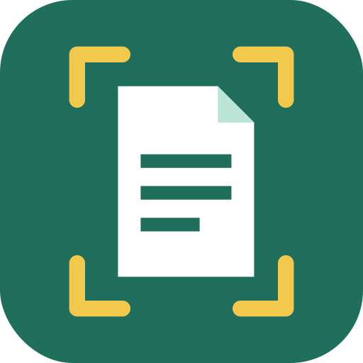

# Simplescan

Einfacher Dokumentenscanner für Android.



- **Scannen:** Kamera über ein Blatt halten. Ein grüner Rahmen zeigt die erkannte Seite; liegt sie ruhig, löst die App selbst aus („Auto“, oben abschaltbar), sonst den runden Knopf drücken. Tippen ins Bild stellt scharf, Blitz unten links. Die Seite wird ausgeschnitten und gerade gezogen, auch schräg fotografiert im richtigen Format (nahe A4 → genau A4). Fotos aus der Galerie gehen über das Bilder-Symbol oben rechts.
- **Seitenübersicht** (nach „Fertig“ oder Tipp aufs Vorschaubild): Filter für alle Seiten (Original, Verbessern, Graustufen, Schwarzweiß; Standard „Verbessern“) oder pro Seite (Schild unten auf der Kachel). Tipp auf eine Seite zeigt sie groß im gewählten Filter (Zoom mit zwei Fingern, Doppeltipp); bei „Original“ öffnet sich das Anpassen der Ecken mit Lupe. Unter jeder Seite: umsortieren, Ecken anpassen, drehen, löschen. „PDF erstellen“ führt zum Speichern-Dialog.
- **Speichern:** als PDF im **Download-Ordner**, in einem **selbst gewählten Ordner** auf dem Telefon oder direkt auf **Nextcloud / WebDAV** (oben auf „Speicherort“ tippen). Vor dem Speichern lassen sich Dateiname und Ziel ändern.
- **Nextcloud / WebDAV:** Server-Adresse, Benutzername, Passwort und Ordner eintragen, „Prüfen und speichern“ tippen. Bei Nextcloud genügt die normale Adresse (z. B. `cloud.example.de`), die App ergänzt `/remote.php/dav/files/<Benutzer>/`. Am besten ein App-Passwort nehmen (Nextcloud → Persönliche Einstellungen → Sicherheit). Meldest du dich mit E-Mail an, trag die vollständige WebDAV-Adresse aus Nextcloud (Dateien → Einstellungen → WebDAV) als Server-Adresse ein. Fehlt der Ordner, wird er angelegt. Gleichnamige Dateien werden nicht überschrieben, sondern bekommen „(1)“, „(2)“ … angehängt. Das Passwort liegt verschlüsselt im Android-Keystore. Hochgeladene Scans öffnen sich aus der Liste im Browser; Teilen schickt den Link.
- **Zuletzt gespeichert:** Antippen öffnet das PDF, das Teilen-Symbol schickt es weiter. Das Brief-Symbol öffnet direkt eine E-Mail: lokal gespeicherte PDFs hängen als Anhang dran, bei Nextcloud kommt ein öffentlicher Link hinein (Nur-Lesen-Freigabe, wird einmal erstellt und dann wiederverwendet), bei anderen WebDAV-Servern die direkte Adresse. Dasselbe geht gleich nach dem Speichern über „Per E-Mail“ im Hinweis unten.
- **Feste Empfänger-Adresse:** auf der Startseite unter „E-Mail an“ festlegen (mehrere mit Komma). Sie steht dann bei jedem Versand per E-Mail gleich im Feld „An“; leer lassen für keine.
- **Mehrere auf einmal verschicken:** einen Eintrag lange drücken, weitere antippen (oder oben „Alle auswählen“), dann oben „Per E-Mail“ oder „Teilen“. Lokale PDFs kommen als Anhänge mit, hochgeladene als Links im Text. Dateien, die du inzwischen gelöscht hast (auf dem Handy oder auf dem Server), verschwinden beim nächsten Öffnen der App aus der Liste. Ist der Server gerade nicht erreichbar, bleiben die Einträge stehen.

Der Scanner ist Teil der App (Kamera über CameraX, Bildverarbeitung mit OpenCV) und läuft komplett auf dem Handy, ohne Google-Play-Dienste. Berechtigungen: Kamera (für den Scanner) und Internet (nur für Nextcloud/WebDAV). Sonst geht nichts ins Netz.

## Installation

Die aktuelle APK gibt es immer unter
`https://github.com/FHeiCode/Simplescan/releases/latest/download/simplescan.apk`

Android 10 oder neuer.

## Build und Release

- Jeder Push baut über GitHub Actions eine APK, zu finden unter *Actions → Lauf → Artifacts*. Dabei laufen auch die Unit-Tests.
- **Release:** Steht in `version.txt` auf `main` eine Version, zu der es noch kein Release gibt, legt der Build das Release `v<Version>` mit APK an. Titel und Text kommen aus `release-notes.md`.
- **Signatur:** Damit Updates sich über die installierte App installieren lassen, im Repo unter *Settings → Secrets and variables → Actions* diese Secrets anlegen:

| Secret | Inhalt |
|---|---|
| `SIGNING_KEYSTORE_BASE64` | Keystore als Base64 (`base64 -w0 release.jks`) |
| `SIGNING_STORE_PASSWORD` | Keystore-Passwort |
| `SIGNING_KEY_ALIAS` | Alias des Schlüssels |
| `SIGNING_KEY_PASSWORD` | Schlüssel-Passwort |

Einen neuen Keystore erzeugst du mit:
```bash
keytool -genkeypair -v -keystore release.jks -alias simplescan -keyalg RSA -keysize 4096 -validity 10000
```

Lokal bauen: `gradle testDebugUnitTest assembleDebug` (Gradle 9.8, JDK 17, Android SDK 35).

## Technik

Kotlin, Jetpack Compose, Material 3, DataStore, CameraX, OpenCV, OkHttp (WebDAV). PDFs schreibt die App selbst (JPEG-Seiten unverändert eingebettet, daher klein). minSdk 29.
